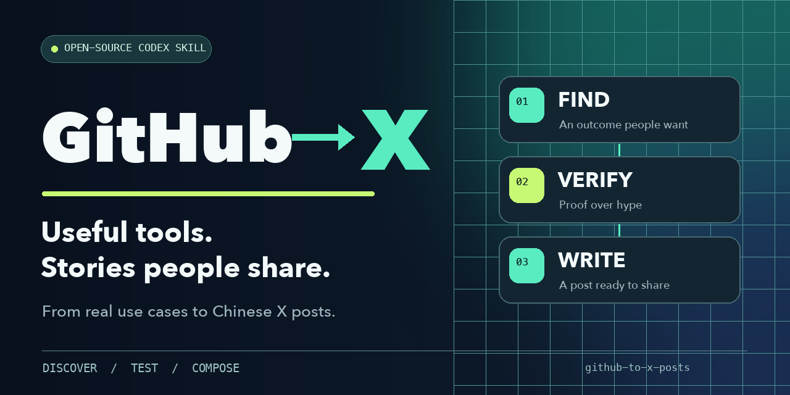

# GitHub to X Posts



A Codex skill for turning useful GitHub discoveries into Chinese-language X posts that people outside developer circles can understand. It finds a promising project, verifies what someone can actually do with it, checks whether the same angle is already everywhere on X, and delivers a ready-to-use post with a media plan.

This is a content research and writing workflow for creators who want more reach. It improves the odds of finding a compelling, credible story; it does not promise a viral post. **The instructions are in English, but the default post output is in Chinese.**

## Quick start

**1. Open Codex.** Give it web access for live research. You do not need to connect your X account to get a draft. To have Codex arrange a draft in the X composer, you will need to provide access to that browser session.

**2. Install the skill.** Paste this into a new Codex chat:

```text
Use $skill-installer to install the skill from the root of https://github.com/Balance0014/github-to-x-posts. If the direct download fails, retry using git.
```

Prefer the terminal? Clone the repository into the [personal skills location documented by Codex](https://learn.chatgpt.com/docs/build-skills):

```bash
mkdir -p ~/.agents/skills
git clone https://github.com/Balance0014/github-to-x-posts.git ~/.agents/skills/github-to-x-posts
```

Start a new chat after installation. If Codex does not recognize the skill, restart Codex and try again.

**3. Run your first search.** Copy this prompt and adjust the category if needed:

```text
Use $github-to-x-posts to find a GitHub tool worth posting about on Chinese X today. Prioritize video creation or editing for everyday users. Verify that the core use case works, note any costs or limits, and check whether the same angle has already been posted on X. Pick the strongest candidate and give me a ready-to-paste Chinese main post with a reusable demo video, plus a separate first-reply GitHub link, media credits, and the evidence behind each claim. I will click Post and add the reply myself.
```

You should receive one recommended project and the reason it was chosen, a clear distinction between firsthand testing and source claims, the finished main post and first reply, a media and ALT plan, working links, and any important caveats. If no candidate passes the checks, the skill should say so instead of inventing one.

## How the workflow works

1. Start with a result an everyday user wants, especially in video creation, editing, design, or other visual tasks.
2. Check the project, the live product, and the path from input to finished output. Test it when practical.
3. Search X for competing posts and look for a distinct, useful angle.
4. Write around the reader's situation and outcome: a strong opening, one clear benefit, and only the proof the claim needs.
5. Lead the main post with a usable demo video when its reuse basis is clear. Provide the GitHub link as a separate first reply by default, with exact copy, attribution, and ALT text. With permission, arrange the main post in X and leave publication and the reply to the account owner.

The operating instructions are in [SKILL.md](SKILL.md). Use the [candidate and draft worksheet](references/run-sheet.md) to keep evidence close to the claims it supports.

## Evidence and media

Separate firsthand observations from an author's demo and from inference. Check reuse rights before using someone else's media; attribution alone is not permission. Recheck time-sensitive details such as pricing, GitHub stars, and X rules each time you use the skill.

This repository contains a general workflow and a blank worksheet. It does not include private account analytics, personal experiments, or anyone's unpublished post assets.

## License

MIT. See [LICENSE](LICENSE).
